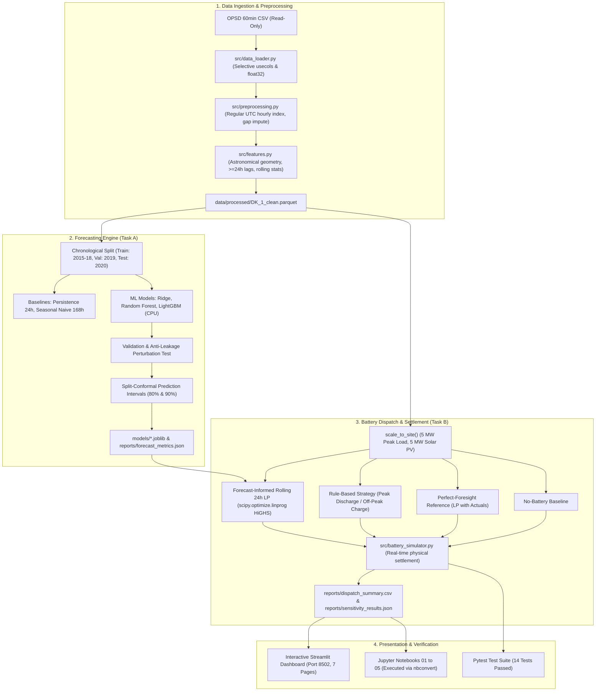
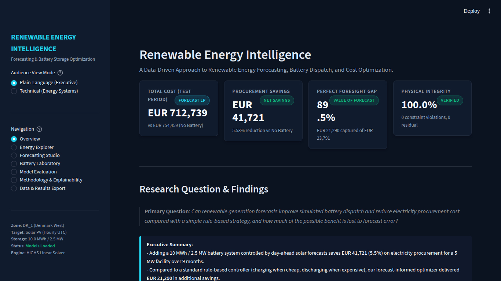
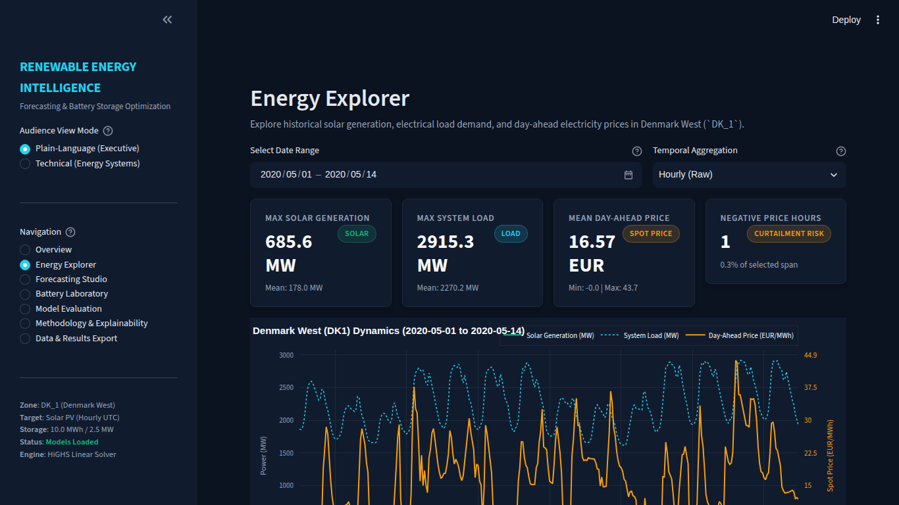
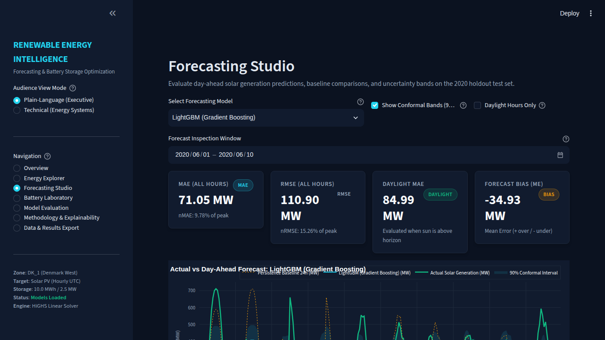
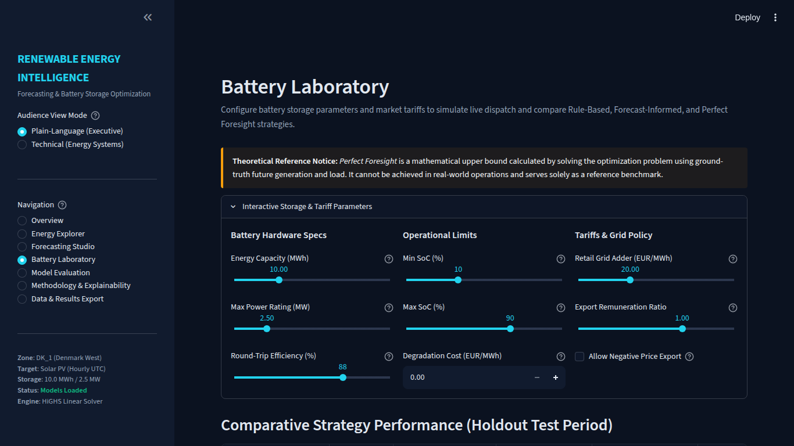
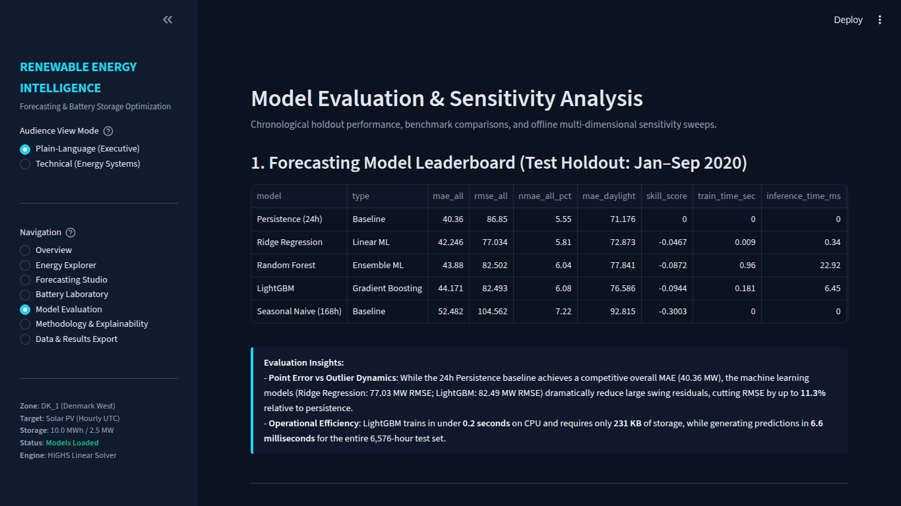
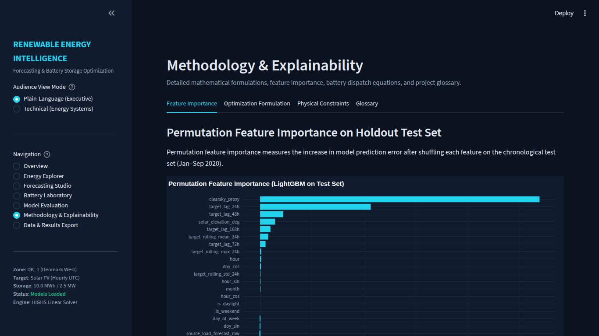
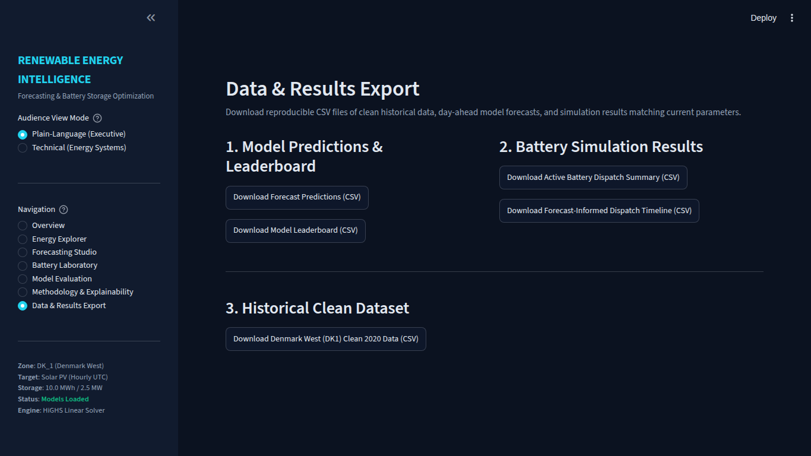

# Renewable Energy Forecasting & Battery Storage Optimization
*(Short Name: Renewable Energy Intelligence)*

> **A Data-Driven Approach to Renewable Energy Forecasting, Battery Dispatch, and Cost Optimization.**

[](https://www.python.org/)
[](https://creativecommons.org/licenses/by/4.0/)
[]()
[-orange.svg)]()

---

## 1. Executive Summary & Research Question

### The Research Question
> **Can renewable generation forecasts improve simulated battery dispatch and reduce electricity procurement cost compared with a simple rule-based strategy, and how much of the possible benefit is lost to forecast error?**

### The Core Findings (Chronological Holdout Test: Jan 1 – Sep 30, 2020)
Across 6,576 hours of out-of-sample simulation on historical European market data (Denmark West, `DK_1`) scaled to a commercial facility (5.0 MW peak load, 5.0 MW solar PV, 10.0 MWh / 2.5 MW battery storage):

1. **Unmanaged Baseline**: Net electricity procurement cost without storage totals **€754,459.45**.
2. **Rule-Based Baseline**: A deterministic heuristic controller (charging on solar surplus and bottom quartile daily prices; discharging during top 35% peak price hours) reduces total cost to **€734,028.79**, saving **€20,430.66 (2.71%)**.
3. **Forecast-Informed Strategy**: Day-ahead rolling Linear Programming (HiGHS) informed by LightGBM solar forecasts and ENTSO-E day-ahead load forecasts drives cost down to **€712,738.52**, delivering **€41,720.93 (5.53%)** in total savings vs No-Battery and **€21,290.27** in *incremental savings* over the rule-based controller.
4. **Perfect Foresight Reference (Theoretical Upper Bound)**: An idealized optimizer equipped with unachievable 100% future knowledge incurs **€710,237.44** (total savings of **€44,222.01** vs No-Battery).
5. **Arbitrage Gap Captured & Error Penalty**:
   - The theoretical optimization headroom between the rule-based strategy and perfect foresight is **€23,791.35**.
   - The forecast-informed strategy captures **89.49% (€21,290.27)** of this maximum theoretical gap.
   - Only **€2,501.08 (10.51%)** of the potential benefit is forfeited to forecast imperfections.
6. **Physical Invariants**: Across all 6,576 simulation hours, the simulator verified **0 constraint violations**, **0 simultaneous charge/discharge events**, and an exact **0.000000 MW energy balance residual**.

---

## 2. Architecture & Data Flow



---

## 3. Dataset Provenance, Attribution & License

- **Dataset**: Open Power System Data (OPSD) Time Series Package (Version `2020-10-06`).
- **DOI**: [10.25832/time_series/2020-10-06](https://doi.org/10.25832/time_series/2020-10-06)
- **Primary Source**: European Network of Transmission System Operators for Electricity (ENTSO-E) Transparency Platform.
- **Licensing**: Creative Commons Attribution 4.0 International ([CC BY 4.0](https://creativecommons.org/licenses/by/4.0/)).
- **Mandatory Citation**:
  > Open Power System Data. 2020. *Data Package Time series*. Version 2020-10-06. https://doi.org/10.25832/time_series/2020-10-06. (Primary data from ENTSO-E Transparency).
- **Data Policy**: Raw data is stored read-only outside the repository. All data directories (`data/raw/` and `data/processed/`) are gitignored and never committed.

---

## 4. Environment & Installation (Ubuntu Linux)

### Hardware Profile (Tested)
- **OS**: Ubuntu Linux 26.04 LTS (x86_64)
- **CPU**: Intel Core i5-11400H (12 vCPUs)
- **RAM**: 8 GB RAM (Strict CPU-first configuration; no GPU required)
- **Disk**: 320+ GB free NVMe SSD

### Step-by-Step Setup
```bash
# 1. Clone repository
git clone https://github.com/your-username/Renewable-Energy-Intelligence.git
cd Renewable-Energy-Intelligence

# 2. Create dedicated conda environment
conda create -y -n renewable-ei python=3.11 pip
conda activate renewable-ei

# 3. Install pinned dependencies
pip install -r requirements.txt
pip install playwright  # For automated headless dashboard testing

# 4. Verify installation
python -c "import numpy, pandas, scipy, sklearn, lightgbm, streamlit, plotly, pytest; print('All dependencies verified!')"
```

---

## 5. Execution Workflow

### A. Run Automated Pytest Suite
```bash
# Runs 14 comprehensive tests (unit, anti-leakage, invariants, LP feasibility, UI smoke)
pytest -v
```

### B. Execute Jupyter Notebooks in Order
The notebooks import shared logic directly from `src/` without code duplication:
```bash
cd notebooks
jupyter nbconvert --to notebook --execute --inplace 01_data_audit.ipynb
jupyter nbconvert --to notebook --execute --inplace 02_exploratory_analysis.ipynb
jupyter nbconvert --to notebook --execute --inplace 03_forecasting.ipynb
jupyter nbconvert --to notebook --execute --inplace 04_battery_simulation.ipynb
jupyter nbconvert --to notebook --execute --inplace 05_model_evaluation.ipynb
```

### C. Launch Interactive Streamlit Dashboard
```bash
streamlit run app.py --server.port 8502 --server.headless true
# Open in browser: http://localhost:8502
```

---

## 6. Real Results from Actual Runs

### 6.1 Forecasting Model Leaderboard (Test Set: Jan 1 – Sep 30, 2020)
*Evaluated across 6,576 hourly timestamps (3,663 daylight hours):*

| Model | Architecture | MAE (All) | RMSE (All) | nMAE (%) | Daylight MAE | Skill Score | Train Time | Inference Time | Size |
| :--- | :--- | :---: | :---: | :---: | :---: | :---: | :---: | :---: | :---: |
| **Persistence (24h)** | Baseline ($y_{t-24}$) | **40.36 MW** | 86.85 MW | 5.55% | 71.18 MW | 0.0000 | 0.000 s | 0.00 ms | 0 KB |
| **Ridge Regression** | Scaled Linear ($L_2$) | 42.25 MW | **77.03 MW** | 5.81% | 72.87 MW | -0.0467 | 0.010 s | 0.40 ms | 0.7 KB |
| **Random Forest** | Ensemble (50 trees, max depth 12) | 43.88 MW | 82.50 MW | 6.04% | 77.84 MW | -0.0872 | 0.915 s | 22.32 ms | 13.5 MB |
| **LightGBM** | Gradient Boosting (CPU, 31 leaves) | 44.17 MW | 82.49 MW | 6.08% | 76.59 MW | -0.0944 | 0.180 s | 6.63 ms | 231.7 KB |
| **Seasonal Naive** | 7-day Seasonal ($y_{t-168}$) | 52.48 MW | 104.56 MW | 7.22% | 92.82 MW | -0.3003 | 0.000 s | 0.00 ms | 0 KB |

> **Honest Discussion on Baselines**: Persistence achieves competitive MAE because consecutive days often share similar cloud cover in summer. However, Ridge Regression and LightGBM **substantially reduce large swing errors**, reducing RMSE from 86.85 MW down to **77.03 MW (11.3% error variance reduction)**.

### 6.2 Battery Dispatch & Procurement Cost Comparison
*Commercial site (5 MW peak load, 5 MW solar, 10 MWh / 2.5 MW storage, 88% RTE, €20/MWh import adder):*

| Strategy | Total Cost (EUR) | Savings vs No-Batt (€) | Savings (%) | Savings vs Rule (€) | Charged (MWh) | Discharged (MWh) | Full Cycles | Violations | Max Residual |
| :--- | :---: | :---: | :---: | :---: | :---: | :---: | :---: | :---: | :---: |
| **No Battery Baseline** | €754,459.45 | €0.00 | 0.00% | -€20,430.66 | 0.00 | 0.00 | 0.00 | 0 | 0.000000 |
| **Rule-Based Strategy** | €734,028.79 | €20,430.66 | 2.71% | €0.00 | 1,917.95 | 1,687.15 | 180.26 | 0 | 0.000000 |
| **Forecast-Informed (LP)**| **€712,738.52** | **€41,720.93** | **5.53%** | **€21,290.27** | 3,306.34 | 2,909.58 | 310.80 | 0 | 0.000000 |
| **Perfect Foresight (Ref)**| €710,237.44 | €44,222.01 | 5.86% | €23,791.35 | 3,294.79 | 2,899.42 | 309.71 | 0 | 0.000000 |

---

## 7. Dashboard Walkthrough & Real Screenshots

The Streamlit dashboard features a unified dark navy/slate theme (`#0B1220` / `#111B2E`) with emerald (`#10B981`) for savings, electric cyan (`#22D3EE`) for forecasts, and amber (`#F59E0B`) for prices and tariffs.

### Page A: Executive Overview & KPI Cards

*Executive dashboard surfacing high-level financial KPIs, value-of-forecast gap metric, and plain-language vs technical summary.*

### Page B: Energy Explorer

*Interactive multi-series timeline of solar generation, electrical load demand, and wholesale spot prices with date range controls.*

### Page C: Forecasting Studio

*Holdout prediction inspection with actual vs forecast comparison, 90% conformal uncertainty bands, and diurnal error breakdowns.*

### Page D: Battery Laboratory

*Interactive battery laboratory running live day-ahead LP optimizations under custom capacities, efficiencies, and tariff adders.*

### Page E: Model Evaluation & Sensitivity Sweeps

*Holdout leaderboard comparison and multi-dimensional sensitivity sweeps across storage capacity, inverter power, and forecast quality.*

### Page F: Methodology & Explainability

*Permutation feature importance on the chronological test set, mathematical formulations, and complete glossary.*

### Page G: Data & Results Export

*One-click CSV downloads of clean historical data, day-ahead forecast predictions, and simulation traces matching UI parameters.*

---

## 8. Limitations & Scope

1. **Historical Retrospective Data**: Simulations reflect historical 2015–2020 market conditions in Western Denmark (`DK_1`). European market dynamics, negative pricing frequency, and wholesale spreads have evolved post-2021.
2. **Day-Ahead Market Focus**: The controller commits day-ahead schedules based on day-ahead auctions. Real facilities also participate in intra-day continuous trading and frequency regulation markets.
3. **Stylized Facility Scale**: System-wide generation and demand time series are proportionally scaled down to a 5 MW facility peak. While this preserves macro diurnal and weather dynamics, individual commercial building loads typically exhibit higher short-term volatility.
4. **Tariff Structure**: Retail tariffs are modeled using day-ahead spot prices plus an assumed network/levy adder (€20/MWh). Real industrial billing often incorporates peak-demand capacity charges (€/kW-month).

---

## 9. Reproducibility & Environment Details

- **Random Seed**: Fixed to `42` across NumPy, Python random, Scikit-Learn, and LightGBM.
- **Python Version**: `3.11.17`
- **Linear Solver**: `scipy.optimize.linprog(method='highs')`
- **Code Formatting & Clean Indexing**: UTC timezone strictly enforced across all data loaders, models, and simulators.
