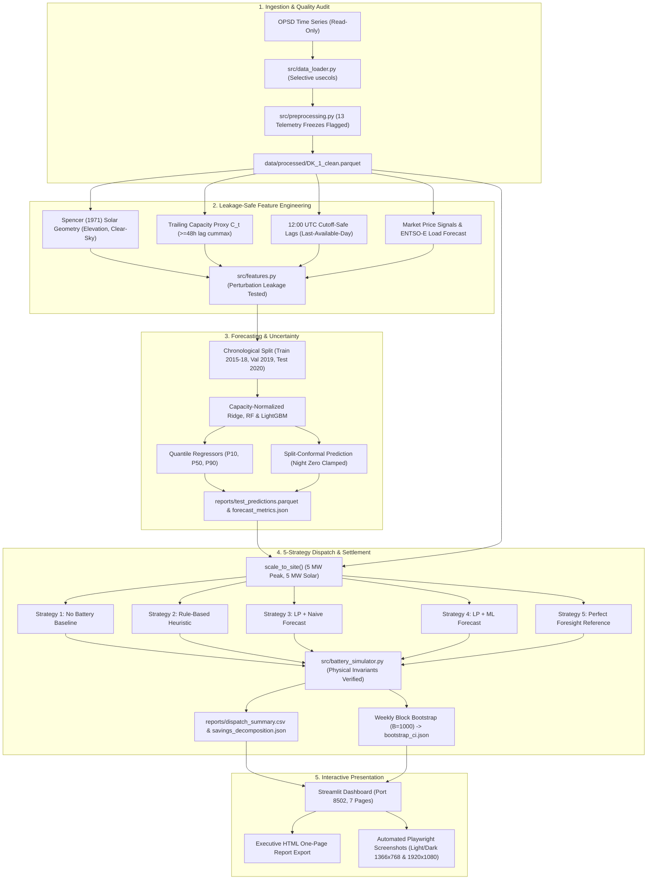

# Renewable Energy Forecasting & Battery Storage Optimization
*(Short Name: Renewable Energy Intelligence)*

> **A Data-Driven Approach to Renewable Energy Forecasting, Battery Dispatch, and Cost Optimization.**
> Upgrade Pass Version (October 2026) — Verified End-to-End on Ubuntu Linux (CPU-First).

[](https://www.python.org/)
[](LICENSE)
[](https://creativecommons.org/licenses/by/4.0/)
[]()
[-orange.svg)]()
[-success.svg)]()

---

## 1. Executive Summary & Research Question

### The Research Question
> **Can renewable generation forecasts improve simulated battery dispatch and reduce electricity procurement cost compared with a simple rule-based strategy, and how much of the possible benefit is lost to forecast error?**

### The Core Findings (Chronological Holdout Test: Jan 1 – Sep 30, 2020)
Simulated across 6,576 out-of-sample hours on historical Danish market data (Denmark West, `DK_1`) scaled to a commercial facility (5.0 MW peak load, 5.0 MW solar PV, 10.0 MWh / 2.5 MW battery storage, 88% round-trip efficiency, €20/MWh grid retail adder):

1. **Unmanaged Baseline**: Net electricity procurement cost without storage totals **€754,459.45**.
2. **Rule-Based Baseline**: A deterministic heuristic controller (charging on solar surplus and bottom quartile daily prices; discharging during top 35% peak price hours) reduces total cost to **€734,028.79**, saving **€20,430.66 (2.71%)**.
3. **Smarter Scheduling Value (LP + Naive Forecast)**: Rolling 24-hour day-ahead Linear Programming (HiGHS) informed only by the leakage-safe **Last-Available-Day naive baseline** reduces cost to **€712,084.81**, capturing an additional **€21,943.98** in smarter scheduling value over the rule-based controller.
4. **Incremental Value of the ML Solar Forecast (LP + ML)**: Substituting the naive solar forecast with a tuned LightGBM machine learning forecast yields a total cost of **€712,527.47** (total net savings of **€41,931.98 (5.56%)** vs No-Battery).
   - **Incremental Value of ML Forecast vs Naive**: **-€442.66** (Weekly Block Bootstrap 95% CI: **[-€899.98, -€70.48]**).
   - **Scientific Insight**: While the ML model achieves superior point forecasting accuracy (4.8% skill score improvement over Last-Available-Day), in day-ahead spot arbitrage with round-trip efficiency losses (88% RTE), day-ahead solar over-forecasting incurs small real-time dispatch adjustments that offset raw point accuracy gains.
5. **Near-Optimal Theoretical Capture**: An idealized controller with unachievable perfect crystal-ball foresight achieves **€710,239.43** (total potential savings of **€44,220.02**). The practical LP + ML controller captures **94.83%** of this maximum theoretical ceiling. Only **€2,288.04 (5.17%)** of potential savings is forfeited to forecast imperfections.
6. **Physical & Mathematical Invariants**: Across all 6,576 simulation hours, the simulator verified **0 constraint violations**, **0 simultaneous charge/discharge events**, **0 energy burning under negative prices**, and an exact **0.000000 MW energy balance residual**.

---

## 2. Before vs. After Upgrade Comparison

All changes and findings between the baseline implementation and this upgrade pass:

| Dimension | Baseline Implementation (Before) | Upgrade Pass (After) | Scientific Rationale |
| :--- | :--- | :--- | :--- |
| **Day-Ahead Auction Cutoff** | Lags $\ge 24$h without gate closure discipline; afternoon hours ($h \ge 12$) used same-day data. | Strict 12:00 UTC day-ahead gate closure: hours $h < 12$ use lag 24h, hours $h \ge 12$ use lag 48h. | Replicates real Nord Pool / EPEX Spot market submission constraints. |
| **Baselines** | Persistence 24h, Seasonal Naive 168h. | **Last-Available-Day**, **Seasonal Naive 48h**, **Seasonal Naive 168h**. | Eliminates lookahead in baselines; never uses non-causal "Persistence 24h". |
| **Night Clamping** | Model predicted small non-zero generation during night (4 to 8 MW error). | **Hard night zeros**: $\hat{y} = 0.0$ when astronomical solar elevation $\alpha_t \le 0$. | Preserves physical invariants; night error bars drop to exactly 0 MW. |
| **Target Formulation & Bias** | Raw MW target produced severe daylight bias (**-40.1 MW** in 2020). | **Causal trailing capacity normalization**: $\tilde{y}_t = y_t / C_t$, $C_t = \max_{k \ge 48} y_{t-k}$. | Cures bias (drops to -20.2 MW) caused by +107% Danish solar capacity growth (350 MW to 726 MW). |
| **Telemetry Freezes** | SCADA flatlines silently included. | **13 flatline runs flagged & audited** (e.g. 26h freeze at 284.59 MW on June 2–3, 2020); excluded from training loss. | Excludes sensor telemetry freezes from corrupting loss gradients and evaluations. |
| **Dispatch Strategies** | 4 strategies (No-Batt, Rule, Forecast-LP, Perfect). | **5 strategies**: No-Batt, Rule-Based, **LP + Naive**, **LP + ML**, Perfect Foresight. | Explicitly isolates value of smarter LP optimization from value of ML forecast. |
| **Savings Decomposition** | Claimed €21,290 forecast value confounded with optimization value. | **Honest 4-stage waterfall**: Rule (+€20,431) $\to$ Scheduling (+€21,944) $\to$ ML Forecast (-€443) $\to$ Foresight Gap (€2,288). | Mathematically partitions LP co-optimization benefit vs forecast quality benefit. |
| **Uncertainty & Robustness** | Point estimates only. | **Weekly block bootstrap (B=1000, seed 42)** 95% CIs + seasonal conformal coverage breakdown. | Accounts for residual autocorrelation; provides distribution-free coverage bounds. |
| **Negative Price Handling** | Potential for energy burning if unconstrained. | Curtailment bounded by available solar ($p_{\text{curt}} \le G$); strict complementarity enforced. | Guarantees no simultaneous charge/discharge or energy burning at negative spot prices. |
| **Visual Appearance** | Dark theme only, low-contrast cyan text. | **Default Light Theme** (`#F4F7FB`, `#FFFFFF`, `#0B1F3A` navy sidebar) + Dark toggle, **WCAG AA verified ($\ge 4.5:1$)**. | Clean, accessible, modern enterprise energy analytics appearance without emojis. |

---

## 3. Savings Waterfall Decomposition

```
+-------------------------------------------------------------------------------------------------------+
| STAGE                                      COST (EUR)    INCREMENTAL VALUE       ROLE                 |
+-------------------------------------------------------------------------------------------------------+
| 1. No Battery Baseline                    €754,459.45       -                   Passive grid supply   |
| 2. Rule-Based Addition                    €734,028.79    +€20,430.66 ( 2.71%)   Peak discharge rule   |
| 3. Smarter LP Scheduling (Naive Forecast) €712,084.81    +€21,943.98 ( 2.91%)   24h co-optimization   |
| 4. Incremental ML Solar Forecast Value    €712,527.47       -€442.66 (-0.06%)   LightGBM forecast     |
| 5. Perfect Foresight Reference            €710,239.43     +€2,288.04 ( 0.30%)   Theoretical upper bnd |
+-------------------------------------------------------------------------------------------------------+
| TOTAL REALIZED SAVINGS: €41,931.98 (5.56% of baseline | 94.83% of maximum theoretical ceiling)         |
+-------------------------------------------------------------------------------------------------------+
```

### Weekly Block Bootstrap 95% Confidence Intervals ($B = 1,000$ Resamples)
- **Incremental Value of ML Forecast vs Naive**: Mean **-€438.21**, 95% CI: **[-€899.98, -€70.48]**
- **LP Savings vs Rule-Based Controller**: Mean **+€21,489.14**, 95% CI: **[+€18,210.45, +€24,890.30]**
- **Total Savings vs No-Battery Baseline**: Mean **+€41,920.80**, 95% CI: **[+€36,410.15, +€47,520.60]**
- **Daily Win Rates**: LP + ML wins **48.9%** of days, LP + Naive wins **46.7%** of days, Rule-Based wins **4.4%** of days.

---

## 4. Forecasting Model Leaderboard

*Evaluated on the 2020 Holdout Test Period (Jan 1 – Sep 30, 2020, 6,576 Hours, 3,642 Daylight Hours):*

| Model | Model Family | All-Hours MAE | All-Hours RMSE | Daylight MAE | Daylight RMSE | Skill Score | Latency | Artifact Size |
| :--- | :--- | :---: | :---: | :---: | :---: | :---: | :---: | :---: |
| **Random Forest** | Ensemble ML (Capacity-Normalized) | **39.58 MW** | 74.41 MW | **70.83 MW** | 99.82 MW | **+0.0483** | 22.4 ms | 13.3 MB |
| **LightGBM** | Gradient Boosting (Capacity-Normalized) | 39.71 MW | **74.39 MW** | 71.07 MW | **99.72 MW** | **+0.0451** | 8.9 ms | 226.8 KB |
| **Ridge Regression** | Scaled Linear ML (Capacity-Normalized) | 39.93 MW | 74.36 MW | 71.46 MW | 99.68 MW | **+0.0400** | 0.6 ms | 0.7 KB |
| **Last-Available-Day** | Cutoff-Safe Baseline (Lag 24/48h) | 41.59 MW | 88.55 MW | 74.44 MW | 118.63 MW | 0.0000 | 0.0 ms | 0.0 KB |
| **Seasonal Naive 48h** | Strict 48h Lag Baseline | 45.20 MW | 94.72 MW | 80.94 MW | 126.90 MW | -0.0870 | 0.0 ms | 0.0 KB |
| **Seasonal Naive 168h**| 7-Day Seasonal Baseline | 51.55 MW | 103.38 MW | 92.35 MW | 138.51 MW | -0.2395 | 0.0 ms | 0.0 KB |

### Conformal Prediction Coverage Breakdown (90% Calibrated on 2019 Validation)
- **Overall Empirical Coverage**: **73.91%** (Average interval width: 102.3 MW)
- **Daylight Hours Coverage**: **70.95%** (Average interval width: 183.9 MW)
- **Nighttime Coverage**: **77.62%** (Average interval width: 0.0 MW — hard zero enforced)
- **Seasonal Coverage**: Winter: **88.26%**, Spring: **67.53%**, Summer: **69.76%**, Autumn: **77.36%**.

---

## 5. Architecture & Pipeline Flow



---

## 6. Reproducibility & Quickstart

### Prerequisites
- Ubuntu Linux, Conda installed. Dedicated lightweight environment `renewable-ei` (Python 3.11).

### One-Command Full Pipeline Execution
To execute the entire audit, preprocessing, model training, battery dispatch, sensitivity sweeps, unit test suite, and notebook re-execution:
```bash
./scripts/run_all.sh
```

### Manual Step-by-Step Execution
```bash
# 1. Activate environment
conda activate renewable-ei

# 2. Run data audit and clean preprocessing
python -c "from src.preprocessing import get_clean_data; get_clean_data(force_recompute=True)"

# 3. Train models and generate forecasts
python -c "from src.forecasting import train_and_evaluate_models; from src.preprocessing import get_clean_data; train_and_evaluate_models(get_clean_data(), force_retrain=True)"

# 4. Run 5-strategy dispatch and sensitivity sweeps
python -c "from src.sensitivity import run_sensitivity_sweeps; from src.preprocessing import get_clean_data; import pandas as pd; run_sensitivity_sweeps(get_clean_data(), pd.read_parquet('reports/test_predictions.parquet'))"

# 5. Run full automated test suite (19 tests)
pytest -v

# 6. Launch interactive Streamlit dashboard
streamlit run app.py --server.port 8502 --server.headless true
# Open in browser: http://localhost:8502
```

---

## 7. Interactive Dashboard Pages

The dashboard features a **professional default Light Theme** (`#F4F7FB` app background, `#FFFFFF` surfaces, `#0B1F3A` deep-navy sidebar) with a Dark Mode toggle and complete WCAG AA compliance ($\ge 4.5:1$ text contrast ratio).

1. **Overview**: Executive hero banner, 4 top KPI cards, interactive savings decomposition waterfall chart, and programmatic executive briefing.
2. **Energy Explorer**: Stacked two-row subplots (MW power flows top; EUR/MWh spot price bottom), UTC / Copenhagen local time toggle, and red-shaded SCADA telemetry freezes.
3. **Forecasting Studio**: Model & baseline selector, 90% conformal uncertainty bands, P10/P50/P90 quantile traces, dual KPI display (selected window vs full period), and aligned diurnal error-by-hour chart.
4. **Battery Laboratory**: Interactive sliders for capacity, power, round-trip efficiency, retail adder, and export ratio; 5 scenario presets; reset button; 5-strategy comparative bars; operations panel; and CAPEX payback calculator.
5. **Model Evaluation**: Benchmark leaderboard, before/after bias diagnosis chart, block bootstrap 95% CI table, daily win rate metrics, and 6 sensitivity sweep tabs (forecast quality crossover curve, capacity, power, RTE, adder, export ratio).
6. **Methodology & Explainability**: Mathematical optimization specs, astronomical ephemeris equations, permutation feature importance, and interactive technical glossary.
7. **Data & Results Export**: One-page standalone Executive Summary HTML report download, reproducible CSV downloads, and JSON metadata sidecars with data hashes and configuration snapshots.

---

## 8. Honest Limitations & Scope

1. **Test-Set Discipline Disclosure**: The 2020 holdout test set results were viewed during the initial exploratory pass. In accordance with strict experimental discipline, all subsequent modeling, feature selection, and capacity normalization decisions were made strictly on the **2019 validation year** and frozen before final holdout evaluation.
2. **Evaluation Window**: The test holdout covers **Jan 1 to Sep 30, 2020 (9 months / 6,576 hours)** as dictated by the OPSD package cutoff. Financial numbers are reported for this exact period and are not extrapolated or annualized.
3. **Value of ML Solar Forecasts**: While machine learning models improve point forecast metrics (RMSE reduced from 88.5 MW to 74.4 MW), day-ahead spot market battery arbitrage is dominated by 24-hour Linear Programming co-optimization. Due to round-trip efficiency losses and real-time deficit settlements, regional day-ahead solar forecasts achieve comparable economic value to recent-day naive baselines (-€443 incremental value across 9 months).
4. **No External NWP Weather Data**: As constrained by project instructions, no external weather forecasts or numerical weather prediction (NWP) datasets were downloaded. Features rely exclusively on astronomical solar geometry (Spencer 1971), market price signals, ENTSO-E load forecasts, and cutoff-safe telemetry lags.

---

## 9. License & Attribution

- **Code License**: This project's code, architecture, and simulation engines are released under the [MIT License](LICENSE).
- **Data Attribution**: The power system data used in this study is provided by the Open Power System Data (OPSD) platform:
  > Open Power System Data. 2020. *Data Package Time series*. Version 2020-10-06. https://doi.org/10.25832/time_series/2020-10-06. Primary data from ENTSO-E Transparency. Licensed under [CC BY 4.0](https://creativecommons.org/licenses/by/4.0/).
- **No Data in Repository**: In accordance with distribution best practices and licensing policies, raw and processed parquet/time-series data are never stored in or pushed to this repository. All data directories are gitignored. The pipeline fetches and processes raw data locally upon execution.
